<!-- Made by Repo Pegboard from SOLID_evidence_v1.2.pdf. The PDF is the original; this page is read back from it. -->

# SOLID evidence

### A defensive publication of how EVERYTHING to solid (formerly STL2STEP) turns triangle meshes into CAD solids, with all the free research behind it

Matthew Armstrong (github.com/The-Dorkknight) · United Kingdom

First published 23 October 2026 · describes EVERYTHING to solid 0.10.2-wip (D1–D15) and its successor Twoo STEP CAD Toolbox 0.11.1-wip (D16–D17)

Repositories: https://github.com/The-Dorkknight/twoo-step-cad-toolbox (current) and https://github.com/The-Dorkknight/stl2step (frozen) · document version 1.2 (2 November 2026: figures and screenshots added; D16 and D17 added; sections 4, 5, 6 and 7 updated; D1–D15 are unchanged from 24 October 2026)

Written with AI assistance (Claude, from Anthropic). Every number in it was measured by the project's own code on a 2-core Linux test machine unless it says otherwise. Not legal advice.

## Abstract

EVERYTHING to solid is a free (non-commercial), offline program that turns an STL mesh, which is a bag of triangles, into a STEP solid, which is the kind of file a CAD program can edit: true planes, cylinders, spheres, surfaces of revolution and smooth NURBS patches, closed into one watertight body. This paper puts every method the program uses, with its parameters and its variants, into the public record, so that nobody can later patent them and stop people using them. It covers seventeen disclosures. The largest are:

- a quad-patch engine for organic shapes: lay the mesh out as quads, turn every quad edge into a curve on the mesh, fill every quad with a Coons patch, then fit the insides of all patches to the mesh at once in one matrix-free solve with a soft "no crease" condition across shared edges, refining the layout from the measured rate of error decrease;
- private outline copies with refusal by tolerance widening, which stops one face's geometric repair from silently damaging its neighbours;
- deterministic input for OpenCascade's plate filler, which made the program's results repeatable;
- a claim ladder with millisecond routing signals, lathe and extrusion roughing, a two-tolerance organic mode, and a set of rules that mean a run on a weak computer always ends with a valid file;

#### (version 1.2) graphics-card scoring that can never fail a conversion, and a per-

- profile triangle ceiling for weak computers, both measured and both with their limits stated plainly (D16, D17).

It also gathers, in one place, the findings of the project's free research reports (literature, measurements, and ideas that turned out to be bad), which are published in full in the same folder.

## 0. Why this paper exists (and why it makes me only slightly more employable)

A patent lets its owner stop everyone else from using an idea for twenty years. You can only patent something that is new: if it was already published, an examiner should refuse the patent, and a granted one can be challenged. A defensive publication is a document written to be that earlier publication. It says, in enough detail for a skilled person to rebuild it, "this is how it is done, and here is the date".

The code has been public on GitHub for a while, so in a sense all of this is already out there. But patent examiners mostly search papers, not Python files, and code doesn't explain why a number is 3 and not 10 or list the obvious variations. This document does both, so it is something an examiner can actually find and cite.

Two honest notes before we start:

1. Most of the big ideas here are not new, and this paper does not pretend they are.
- Four-sided patches fitted to a quad layout of a mesh go back to Eck and Hoppe in 1996; Coons patches to 1967; the quad remesher is QuadriFlow (2018). Section 2 lists the prior art. What is published here is the specific combination, the specific engineering that made it work on cheap hardware, and the measurements.
1. Publishing this also stops me patenting any of it, in the UK and Europe at once (they require absolute novelty). That is the point: the project is source-available for non-commercial use, and the aim is that the methods stay usable by everyone, while the code stays under its licence (PolyForm Noncommercial 1.0.0).

Running tally: after the hardpoint paper (A POINT of contention), this is the second defensive publication. Each one makes the author approximately 0.4 % more employable, which at the current rate means a job offer some time in 2061.

## 1. Background in five minutes

STL stores a surface as triangles: three corner points and a direction each. A cylinder is 60 thin strips; a cat's face is 40,000 tiny flat bits. STEP stores faces: each face is a piece of a mathematical surface (a plane, a cylinder, a NURBS sheet) cut out by a closed outline of curves. CAD programs want STEP because you can pick a hole and change its diameter. Turning one into the other means answering, for every triangle, "which real surface were you trying to be?"

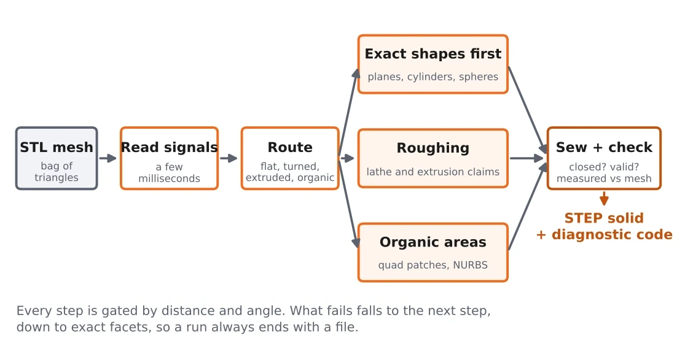

- Figure 1. The whole method on one page. A mesh is read for a few cheap signals, routed, and its surface is claimed by the cheapest method that fits; everything is then sewn, checked and measured against the mesh. (Schematic.)

Four terms used throughout:

- Tolerance: how far a face may sit from the mesh. The program's default is 0.05 % of the part's diagonal (about 0.03 mm on a 60 mm part).
- Trimming: a NURBS surface is naturally a rectangle. If the region you fit is not foursided, you fit a bigger rectangle and cut the region's outline out of it. The cut must lie exactly on the surface and must not cross itself; zig-zag outlines traced along mesh edges break both rules, and that is where faces fail.
- Facets: the last resort. A triangle that could not become part of a real surface is written as its own flat face. A file of facets is valid and closed, but huge and useless for editing. In Fusion they show up as dense black scribbles.
- Sewing: joining separate faces into one closed shell by finding edges that nearly coincide.

The failure that started it. The first measurements, on a 160,000-triangle organic test ghost, were 41 minutes and a 107 MB STEP of 40,484 faces, of which 331 were real NURBS surfaces. The rest were facets. Two thirds of the time went into OpenCascade's "plate" filler, the slow fallback for a patch that would not fit. Everything below is, one way or another, about not ending up there.

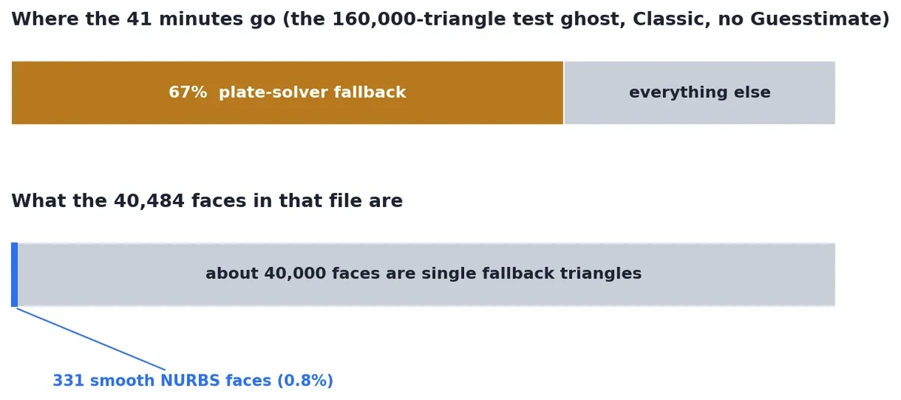

- Figure 2. Where the 41 minutes went, and what the 40,484 faces were (160,000-triangle test ghost, first measurements).

## 2. Prior art: what this paper does not claim

- Coons patches (S. A. Coons, Surfaces for Computer-Aided Design of Space Forms, MIT, 1967) and Gordon surfaces (W. J. Gordon, blending-function methods, 1971): a surface defined by its four boundary curves.

#### Fitting B-spline patches to a quad layout of a mesh, with continuity between

- patches and refinement to a tolerance: M. Eck and H. Hoppe, Automatic reconstruction of B-spline surfaces of arbitrary topological type, SIGGRAPH 1996 (project page). V. Krishnamurthy and M. Levoy, Fitting smooth surfaces to dense polygon meshes, SIGGRAPH 1996.
- Field-aligned quad remeshing: W. Jakob, M. Tarini, D. Panozzo, O. Sorkine- Hornung, Instant Field-Aligned Meshes, SIGGRAPH Asia 2015; J. Huang, Y. Zhou, M.
- Niessner, J. Shewchuk, L. Guibas, QuadriFlow, SGP 2018; D. Bommes, H. Zimmer, L.
- Kobbelt, Mixed-Integer Quadrangulation, SIGGRAPH 2009.
- Commercial auto-surfacing (Geomagic Design X, SpaceClaim Auto Skin, Fusion's Convert Mesh, Rhino's QuadRemesh → SubD → NURBS route): all split exact shapes from freeform areas and cover the freeform areas with four-sided patches. None publishes its exact method or any measured numbers.
- Axis detection from line geometry: H. Pottmann and colleagues (2004 onwards) on recognising surfaces of revolution and helical surfaces from normal lines through a small eigenproblem.
- Anytime fitting: D. Barath and J. Matas, Progressive-X, 2019 (an algorithm whose interrupted result is still valid).
- Progressive meshes and vertex ancestry: H. Hoppe, 1996.
- OpenCascade itself ( GeomFill\_BSplineCurves , BRepFill\_Filling , ShapeFix\_Face , BRepBuilderAPI\_Copy , BRepAlgoAPI\_Defeaturing ) and its documented behaviour.

What is disclosed below is how these pieces are chosen, ordered, tuned, guarded and combined, the specific inventions in between (marked Disclosed:), and every variant the author could think of, because a defensive publication protects only what it describes.

## 3. The disclosures

Each disclosure has the same shape: the problem, the method as built (with the numbers used), what it measured, and variants that are disclosed just as much as the version in the code.

#### ▲D1. The claim ladder: exact shapes first, each gated by distance and angle

Problem. Fitting a freeform surface to everything is slow and fails at the trimming step. Most real parts are mostly exact shapes.

Method. Regions of the mesh are offered, in order, to a ladder of "rungs" from exact and cheap to approximate and slow: plane → cylinder / cone / sphere → surface of revolution → extrusion → freeform patch → Coons fill → plate fill → facets. A rung claims a region only if the fitted surface passes two gates against the original, full-resolution mesh:

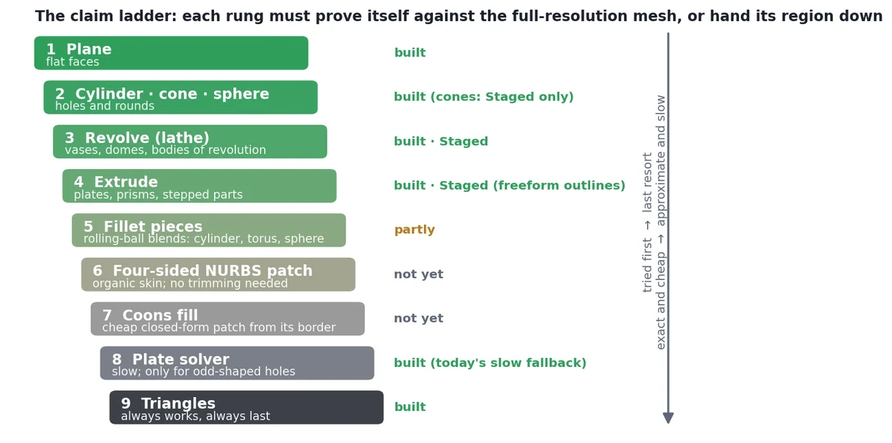

- Figure 3. The claim ladder: try the cheapest exact shape first and fall down a rung only when a gate fails.
1. every vertex within the tolerance (distance gate), and
1. every triangle's normal within an angle of the surface normal at that point (normal gate).

Disclosed: the distance gate alone is not enough. On a 20 mm region, any cylinder with a radius above about 1 m passes a 0.05 mm distance test as a plane; the program's own flatface detector once accepted a 15 mm fillet as a run of flats for that reason. The normal gate catches it. Region borders between flats are judged by edge length, not edge count: a border counts as "sharp" when at least half of its length is sharp, which stops a coarse cylinder's facets being claimed as flats (the count version let them through on meshes with many short edges).

Tolerance becomes a property of each region (tight on exact faces, looser on organic ones, see D4) rather than a switch for the whole file.

Variants disclosed. Any order of rungs; any subset; rungs added (tori, fillet spines, pipes, helical surfaces); the normal gate as an angle, a dot product, or a distance-weighted combination; gates computed on vertices, triangle centres, edge midpoints, or a sampled grid; the length rule with any fraction (the code uses one half).

#### ▲D2. Routing in milliseconds, and "run both, keep the better"

Problem. The same pipeline that makes a turned vase 20 times faster makes a flat plate twice as slow. Work that cannot succeed (looking for flats on a blob) is still paid for.

Method (the Ladder engine, app/ladder.py ). Before any fitting, three signals are computed from the mesh's own data, with no rendering:

1. The dihedral-angle histogram. The angles between neighbouring triangles form a peak at the exporter's facet angle; the first valley after that peak becomes this mesh's sharp-edge threshold.
1. Sharp-bounded flats: the area of clusters of identical normals whose border is at least half sharp edges (by length), and the area of walls square to a candidate axis.
1. Lathe share: about each candidate axis (the biggest normal peaks and the
- eigenvectors of the normal scatter), the share of curved area whose normals lie within 5° of the plane through the axis.

Routing rules: prismatic when sharp-bounded flats cover at least 30 % and flats plus walls at least 75 %; lathe when at least 85 % of curved area turns about one axis; organic when there are no sharp-bounded flats, no lathe axis and under 2 % of edge length is sharp; otherwise mixed. Each route switches searches off or on (an organic part skips the flat and cylinder searches entirely and accepts organic patches at the looser tolerance; a lathe part has its surfaces of revolution claimed before the flat search; a prismatic part has its extruded outlines claimed first).

Disclosed: run both, keep the better. When the route's fast result is more than twice the tolerance from the mesh, the plain fitter is run as well and the result closer to the mesh (then the one with fewer faces) is kept. A "best" engine applies the same rule to two different fitters always.

Measured. The signals routed 25 of 26 test meshes as intended. A dense lathe vase: Classic 264 s and 8,980 faces; Ladder 8.0 s and 14 faces at 0.025 mm. A stepped shaft with a cross hole: 2,190 facets → 8 faces, 0.007 mm, 1.8 s. Over 12 test meshes the prismatic-first change took Quick's total faces from 4,767 to 1,574 and its worst deviation from 3.0 mm to 0.19 mm.

Variants disclosed. Any histogram-derived threshold (valley, knee, percentile); any thresholds for the routes; more routes (sheet metal, pipe, scan); per-component routing instead of per-part; routing learned from the signals; running fitters in parallel processes and keeping the better result; "better" judged by deviation, face count, area on exact faces, or a weighted score.

#### ▲D3. Lathe and extrusion roughing

Problem. A turned part has thousands of triangles but one profile.

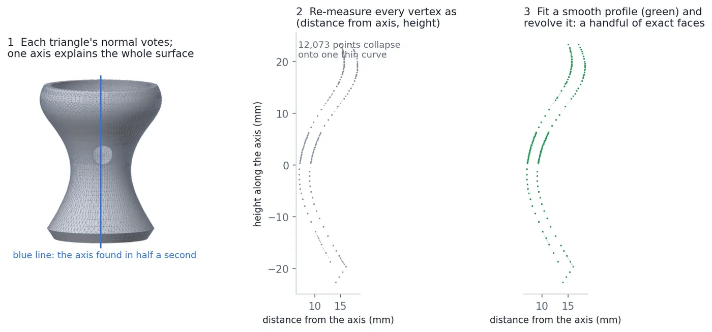

- Figure 4. Roughing a turned part: find the axis, re-measure every vertex as distance against height, and the whole vase collapses to one curve.

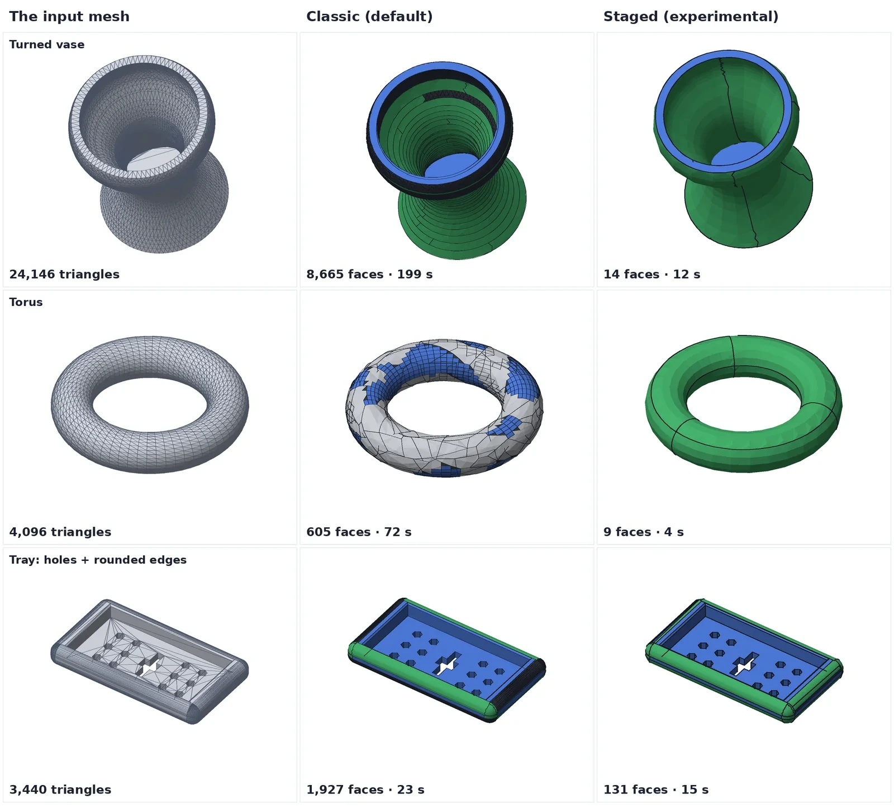

- Figure 5. Same three parts, Classic against Staged: vase 8,665 faces against 14, torus 605 against 9, tray 1,927 against 131.

Method (the Staged engine, app/rough.py ).

1. Axis. On a surface of revolution every normal line meets the axis. Each triangle contributes its centre and normal to a 6 × 6 symmetric matrix (Plücker-style line coordinates); the eigenvector of the smallest eigenvalue gives the axis. Disclosed: the fit is re-weighted a few times so triangles that don't belong (a flat end, a cross hole) stop counting.
1. Profile. Every vertex is re-measured as (distance from axis, position along axis). A whole revolution collapses into one thin curve, ordered along one cut through the axis and fitted with the smoothest spline that explains the points. A profile that is a straight line or an arc centred on the axis is replaced by the exact line or arc, so the face becomes a true cylinder, cone or sphere.
1. Membership. A triangle belongs if its corners are within tolerance, it faces the right way, and its middle and edge midpoints are no further from the surface than the mesh's own chord sag allows (Disclosed: this catches a surface that bows away between the corners because it was fitted to too few points). Near misses touching accepted triangles are taken too, small enclosed islands are filled (so a noisy mesh does not pepper the face with pin-holes), and triangles near the axis, where the surface is singular, are left for the patch fitter.
1. Building. The region is cut into pieces that do not wrap past the surface's seam (cuts snap to rows of mesh edges). Disclosed: each outline edge's curve in the surface's own (angle, profile) coordinates is computed directly in closed form, with its true distance from the surface as the edge tolerance; no projection or repair pass is involved. Outline curves are kept only if they stay with the polyline they replace (chains with a real corner stay polylines; arcs through too few or unevenly spaced points are refused), and every swept face's outline is checked for crossings in its own coordinates before building.
1. Write, read back, demote. The result is written to STEP and read back. Disclosed: a face that doesn't survive the round trip makes only its own region fall back to facets, instead of the whole part.

Extrusions are the same idea with a direction instead of an axis (a 3 × 3 problem on the normals); the classic plane / cylinder split still gets the first say, and the extrusion face is used only where a handful of exact pieces can't explain the area (ovals, spline-shaped walls).

Measured. Vase 8,665 → 14 faces (199 → 12 s), torus 605 → 9 (72 → 4 s), fine tray 1,927 → 131, all at equal or lower deviation. Roughing claimed 79–81 % of the test ghost's surface.

Variants disclosed. Any line-geometry formulation (Plücker coordinates, normal-line least squares, Hough voting on axes); helical surfaces (non-zero pitch); profile fits by any spline, arc-line chain or implicit curve; the chord-sag test with any multiple of the measured sag; demotion of single faces after any validation, not only a STEP round trip.

#### ▲D4. Two tolerances for organic areas, and reduction with locked outlines

Problem. For an organic area (a cat's cheek) 0.3 mm is plenty; for a bearing seat 0.03 mm is not negotiable. One global tolerance is wrong for one of them.

Method (Guesstimate, opt-in).

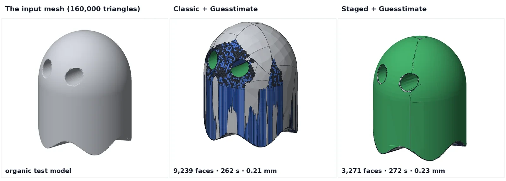

- Figure 6. The test ghost: input mesh, then the two engines with the organic tolerance loosened (flat faces and holes stay exact).

#### Disclosed: a freeform patch is accepted when its inside is within the organic

- tolerance (default 0.3 mm) and its outline is within twice the tight tolerance.
- Planes, cylinders, spheres and all edges keep the tight tolerance. Because outlines stay tight, neighbouring faces still sew exactly; the plate filler is skipped.
- Dense meshes (30,000+ triangles) are reduced first, but never blindly: the mesh is cut into smooth pieces at its sharp edges, and each piece is simplified on its own with every outline point locked, so sharp edges and hole rims cannot move. Each reduced piece is checked both ways against the original (mesh → piece and piece → mesh, because quadric simplification promises no maximum error) and kept closed. In Classic every piece keeps a third of the tight tolerance; in Staged, pieces that are exact shapes keep that tight budget and must still sit on their exact surface, while organic pieces may use a sixth of the organic tolerance and the patch fit gets the rest.
- Fitted surfaces are always measured against the full original mesh.
- Disclosed: flat faces are rebuilt from their outline alone (earcut), and the outline points earcut drops on straight stretches are put back by fanning, one stretch at a time on the current triangles, after dropping zero-area triangles; the result is accepted only if its border edges are exactly the outline's edges, otherwise that region falls back to the outline-locked simplifier.

Measured. The 160,000-triangle ghost: 41 min → 4.3 min, 107 MB → 28 MB, 40,484 → 9,239 faces, max deviation 0.105 → 0.211 mm (inside 0.3). A 224,000-triangle plate reduced to 22,000: 12 exact faces at 0.005 mm, where blind reduction gave 44 fragments and 5 mm of damage. A 220,000-triangle tray: reduced to a closed 48,400-triangle mesh in 0.8 s.

Variants disclosed. Any pair of tolerances, set per region type, per route, from curvature, from a hardpoint label or by the user painting areas; outline tolerance any multiple of the tight one; any simplifier (quadric, vertex clustering, edge collapse with ancestry);

certification by sampled two-sided distance, Hausdorff estimate or SDF.

#### ▲D5. Private outline copies, refusal by widening, and the all-round exception

Problem. OpenCascade's face repair ( ShapeFix\_Face ) makes a wire close on a surface that misses it by raising the tolerance of the wire's vertices. When neighbouring faces share those vertices (which is the normal way to make them meet), the widened tolerance spreads to the neighbours. Every later check accepts anything within a vertex's tolerance, so a neighbouring face 1.3 mm off passed as valid; one knob vertex went from 0.03 mm to 4.7 mm. The same accident, falling the other way, refused good patches next to the widened vertices.

Method.

1. Disclosed: each fitted (NURBS) or flat face is built and repaired on its own deep copy of its outline ( BRepBuilderAPI\_Copy of the whole wire, so the copy still shares vertices internally). The repair can only widen the copy.
1. Disclosed: because a private copy hides the damage from everyone else, a face is refused as a fit when its repair widened the outline's tolerance by more than twice the tolerance (measured as the face's largest vertex/edge tolerance after repair minus before). Twice, not once: once refused good patches too (the blob 24 → 46 faces, 0.06 → 0.13 mm; the torus 526 → 1,132), twice is what the assembly's sewing closes anyway.
1. Disclosed (0.10.1): the all-round exception. Round faces (cylinders, spheres) get private copies too, unless every chain of their outline borders another round face. The two halves of a sphere only build on a shared seam (the first half's repair fixes the seam for the second); with private copies they came out as a shell of two identical halves with a volume of 0.11 mm³.
1. The faces are then joined by sewing at a small tolerance, which re-unites the private copies.

Measured. The ridged knob: 1,103 faces / 0.129 mm (0.9.x) → 963 / 0.058 mm (fitted and flat faces private) → 69 / 0.058 mm (round faces too). Over 12 meshes, Classic 13,996 → 13,102 faces, Quick 1,574 → 680, Staged 1,478 → 588, the other eleven meshes identical.

Variants disclosed. Copies per face, per region or per chain; copies made only when a repair is about to run; any refusal threshold (absolute, relative to the tolerance, relative to the neighbouring edges' lengths); restoring the shared outline after repair instead of copying; the exception decided per chain rather than per face; the same rule in any B-rep kernel whose repair widens tolerances (Parasolid, ACIS, a custom one).

#### ▲D6. Deterministic input for the plate filler

Problem. The program's results differed from run to run on the same file. Traced to BRepFill\_Filling : given the same loose edges, it succeeded in one process and threw a nullvertex error in another, consistently within a process. The filler chains loose edges itself through maps hashed on memory addresses, so a different memory layout gives a different chaining order and, on an outline with a 0.03 mm edge, sometimes a null vertex. (Reversed edge order: worked. Private copies of loose edges: always failed. Edges from a pre-built wire: always worked.)

Method. Disclosed: the program chains the outline edges itself (end point to end point, each edge kept as given), leaves out edges shorter than the filler's own tolerance (max(1e-4, 0.2 × tolerance)), and hands the filler a private copy of that one chained wire, because the filler alters the edges it is given. The resulting surface is identical to the old one whenever the old code happened to succeed (G0 error 1.43e-14 both ways).

Measured. Three traced runs of the vase: identical in every decision; the benchmark repeats.

Variants disclosed. Ordering by any deterministic key (coordinates, indices, arc length); merging short edges into neighbours instead of dropping them; any filler or constraint solver that chains its own input; hashing by content instead of address.

#### ▲D7. Always finishing: checkpoint, ceiling, memory gate, capped facets, face cache

Problem. On a weak laptop ("potato": a 7th-generation i3, 8 GB) an organic job may legitimately grind for hours, but must never end with nothing. An out-of-memory inside OpenCascade cannot be caught from Python: Linux kills the process, Windows pages itself into a hang.

Method.

#### Disclosed: a checkpoint STEP before the dangerous stage. On meshes of

1. 20,000+ triangles, before the freeform passes, every region typed "freeform" is retyped "facet", the shape is assembled and sealed, written to a temporary file and moved over the target atomically. If the fitter dies (any exception, a MemoryError included), the checkpoint is kept.

#### A time ceiling and a plate-fill allowance per performance profile (Potato 2.5 h /

1. 20 fills; Moderate and Extreme 40 min / 60–120). Past the ceiling, patches still outside tolerance become facets at once, at most two more passes re-fit their neighbours, and the solid is assembled. The start time is carried over every rebuild of the mesh context (a bug once let reduced meshes reset it).

#### Disclosed: the plate filler is skipped when the process already holds 75 % of

- the machine's memory, since that is where OpenCascade's memory explodes.
- The faceted fallback is reduced within half the tolerance above 20,000 triangles, so the file stays openable.

#### Disclosed: a cache of built-and-checked faces, keyed by the region's triangles

- and the exact state of its boundary chains, reused across rebuild cycles as a deep copy (a reused face object would be mutated by sewing). Bit-identical output; about half the regions skipped per repeat cycle.
- Facets join without sewing when every edge is shared (the shell is built directly;
- sewing alone took 69 s on a 48,400-facet tray).
- Each job runs in its own worker process; Cancel kills it; workers run at low priority and keep the machine from idle-sleeping.

Variants disclosed. Several checkpoints (after every rung); checkpoints of any quality (exact faces plus reduced facets, plus Coons fills); a hard ceiling by running risky calls in a child process with a timeout; memory gates at any fraction or by predicted memory; caches keyed by any hash of region and boundary state.

#### ▲D8. The quad-patch engine for organic shapes (the big one)

Problem. On organic shapes the region-and-trim approach gives either a few big trimmed patches that miss the tolerance, or facet areas where trimming fails, and creases where trimmed patches meet at an angle.

Method ( app/quadfit.py , opt-in, --engine quad ).

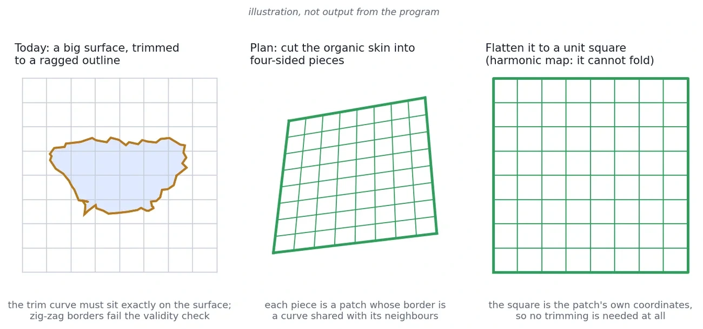

> Figure 7. Why four-sided patches: a big trimmed surface (left) is hard to keep inside the tolerance; a patch with four sides maps onto a unit square (right).

1. Quad layout. QuadriFlow (BSD-3) is run as a separate program (OBJ in, OBJ out, -f N -seed 0 ) so a crash in it cannot take the app down. Where it is missing, or fails to start (detected once and remembered), the Instant Meshes package is used instead ( vertex\_count=-1, face\_count=N/4, deterministic=True ) and its quad-dominant output is split once into all quads (each polygon to quads through its centre and edge

> midpoints). Degenerate quads are dropped; the layout must be closed (every edge used exactly twice).

1. Corners onto the mesh. Every quad corner is moved to its nearest point on the mesh. Disclosed: a KD-tree of triangle centres is queried for the 16 nearest triangles and the exact closest point is computed on those, vectorised; it matched the exact alltriangle search to 1e-6 mm on the test blob and replaced 8 of 13 s.
1. Edge curves. Every quad edge becomes one cubic B-spline interpolated through 7 points: the edge sampled evenly and projected onto the mesh. Disclosed: every curve is interpolated on the same uniform parameters (0, 1/6, …, 1), so every edge curve in the whole model has an identical knot vector. Two neighbouring patches share the very same curve object along their common edge.
1. Coons patches. Every quad is filled with a Coons surface from its four curves ( GeomFill\_BSplineCurves , Coons style). Untrimmed: the face's outline is the surface's own boundary. No plate solve, no trimming, no pcurve problems.
1. Interior fit. A Coons surface only knows its edges. Two knots are inserted in each direction (this does not change the surface), then the inner control points are found by least squares against the nearest mesh points of a grid of surface points; boundary control points are held so neighbours still meet exactly. Disclosed: because every patch has identical knots and the same sample grid, every patch has the same design matrix, which is computed once and shared (a dense 0.5 MB matrix per patch earlier hit a 6 GB out-of-memory guard on a spiky blob; shared, the same blob needs 1.4 GB).
1. Disclosed: joint fit with a soft crease condition. After two independent leastsquares rounds, all patches are solved together. For every shared edge and every control-point row across it, a seam term asks that the last inner control point of one patch, the shared boundary point and the first inner control point of the other lie on one straight line through it, on opposite sides, with the two arms keeping the ratio of their current lengths: the row is P\_a + λ·P\_b = (1 + λ)·P\_0 with λ = |P\_a − P\_0| / |P\_b − P\_0|. That is the condition for the two patches to meet without a crease (tangentplane continuity). It is a soft term with weight μ = 3 (SEAM\_WEIGHT): weight 1 left seams up to 3.3°, weight 10 fought the fit (seams up to 11°, 1,226 quads), a rigid constraint cost too much accuracy (5,116 quads and still outside tolerance). The system is never formed: a matrix-free conjugate-gradient solve on the normal equations with per-patch blocks AᵢᵀAᵢ + reg·I, the seam rows added on the fly, and a diagonal preconditioner.
1. Disclosed: revert rule. Any patch the joint fit made worse than its plain Coons surface goes back to the Coons surface (its edges are the same curves, so the solid still closes).
1. Faces and solid. Faces are made straight from the untrimmed surfaces and sewn on their identical edges at max(1e-5, 0.01 × tolerance); the solid is checked closed and valid and measured against the mesh with the exact search.
1. Disclosed: refinement from the error-decrease rate. The first layout has 60 quads. After each layout the maximum deviation is compared with the tolerance; the next quad count is predicted from the rate at which the error fell between the last two layouts: with error taken as proportional to count to the power −k, k = ln(d1/d2) / ln(n2/n1), clamped to 0.5–3, and the next count n2 · (d2 / tolerance)^(1/k) × 1.15;
- without two improving layouts, twice the last; always at least a third more than the last; up to 6,000 quads, eight layouts or the profile's time ceiling. The closest result is kept.

Measured (faces, max / mean deviation in mm, wall time; seam angles median / 95th percentile / worst):

Shape (triangles; | Quad patches | Classic

- tolerance)

Blob (9,944; 0.028) | 492 faces, 0.022 / 0.004, 38 s; seams | 24 faces, 0.057 / 0.011, 8 s; 0.42 /

1. 0.05 / 0.19 / 1.1° 1.2 / 2.2°

Finer blob (20,480; 0.036) | 59, 0.017 / 0.004, 3.6 s; 0.01 / 0.07 / | 16, 0.024, 42 s

1. 0.19°

Bumpy ring with a hole | 1,787, 0.028 / 0.004, 0 facets, 124 s; | 1,044, 0.144, 50 facet areas, 31 s;  
(9,216; 0.038) | 0.07 / 0.31 / 3.2° | 4.3 / 17 / 32°  
Organic figure (162,036; | 57, 0.010 / 0.002, 7.3 s | 19, 0.015, 421 s

0.029)

Italic: outside the tolerance. The only engine within tolerance on every organic test shape, never leaving facets. Ablations: plain Coons patches needed 5,921 quads for the blob's tolerance (86 s); with the interior fit 347 (16 s); with two inserted knots 117 (9 s); then the seam term for smooth joins.

Variants disclosed. Any quad or quad-dominant remesher (QuadriFlow, Instant Meshes, mixed-integer quadrangulation, Catmull–Clark of a triangle mesh, a hand-drawn layout, a layout from hardpoint labels); any number of samples per edge and any curve degree; parameters uniform, chord-length or any scheme shared by all edges; Gordon or bicubically blended Coons patches instead of bilinear; any number of inserted knots; the seam condition as collinearity, as equal cross-boundary derivatives, or as a G1 normal-alignment penalty; any weight or schedule of weights; solving by conjugate gradients, LSQR, sparse Cholesky, multigrid, alternating per-patch updates, on a CPU or a GPU; the revert rule against any baseline; refinement by any predictor (rate, curvature, local subdivision of only the failing quads, T-junction-free adaptive layouts); output as STEP, IGES, T-splines or SubD.

#### ▲D9. When to use quad patches, and when to hand over

Problem. Quad patches round over sharp edges and waste faces on shapes that have exact descriptions.

Method. Disclosed: the engine takes a part only when it is closed and sharp-bounded flats cover under 5 % of its area and under 0.2 % of its edge length is sharper than 30° and it is not a turned shape (under 85 % of the curved area about one axis). Anything else is handed to the Classic converter, with the reason in the log; a failure at any point does the same. The thresholds were set by failures: a ridged knob passed a 2 % rule and came out 0.52 mm off (ridges rounded); a sphere and a torus came out at 55 and 221 faces where the lathe route gives 2 and 9 exact faces.

Variants disclosed. Per-region rather than per-part routing: quad patches on the organic regions, exact faces on the rest, meeting on shared curves (not built yet, see section 6); any thresholds or signals.

#### ▲D10. Jetwash: batched defeaturing with a cheap test first

Problem. STEP files from early CAD work or other converters carry junk: 0.1 × 0.3 × 0.0001 mm slivers, steps, fins, specks. OpenCascade can remove faces

( BRepAlgoAPI\_Defeaturing ), but the cost grows faster than the number of faces removed (1 face 0.11 s, 16 faces 4.8 s, 81 faces 38 s and failed).

Method. Disclosed: candidates below a user threshold are removed in batches of up to 16 while batches succeed; after a failed batch, one at a time; after 4 single successes in a row, batching resumes. Each trial result is tested by volume first (0.05 s) and only then by the full validity check (0.15 s); any removal that would damage the part is undone.

Measured. The fine tray 102 → 63 s; all 12 test files identical results.

Variants disclosed. Any batch size, adaptive batch size, streak length; bisection of failed batches; any cheap pre-test (volume, area, bounding box, face count).

#### ▲D11. Smooth sketch: when a straight stretch is really a line

Problem. Redrawing a traced outline with lines, arcs and splines: a spline through everything loses the real straight edges; lines everywhere lose the curves.

Method. Disclosed: a stretch counts as a real line when a smooth curve through its surroundings would have to bow away from it far more than the ordinary chords of that loop do (the mesher put no points there because none were needed). Each loop is tried as a circle; otherwise split at sharp corners and real lines, each remaining stretch an arc or a least-squares spline with the fewest control points still within tolerance; a loop with no corners or lines is tried as an ellipse, then a closed spline. Every fit is checked both ways against the points.

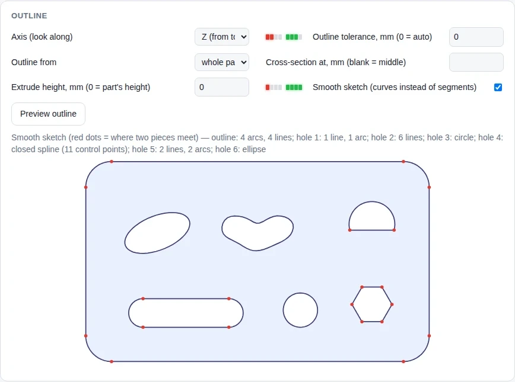

- Figure 8. Smooth sketch: a traced outline redrawn as lines, arcs and splines instead of many tiny straight segments.

Measured. A test plate: 25 faces, the same as the original CAD model (94 without it, 319 at 0.02 mm); its ellipse comes back as one ellipse, its bean-shaped hole as one 11-control-point spline.

#### ▲D12. A diagnostic code for one-screenshot bug reports

Method. Disclosed: a job's settings, profile and result are packed into one string ( S2S1-H…- C…-R…-K… : header, settings, result, error class, check), each record a row of a lookup table of bit fields written in Crockford base32, about 90 characters, which fits a 33 × 33 QR code (the same facts as JSON need 93 × 93). The plain-words panel next to it is produced by decoding the same string, so the QR and the text can never disagree. File names, paths and logs are never put in it. Measured: three phone photos of a real macOS screen, taken at an angle with moire and glare, all read first time and decoded to every field (section 5).

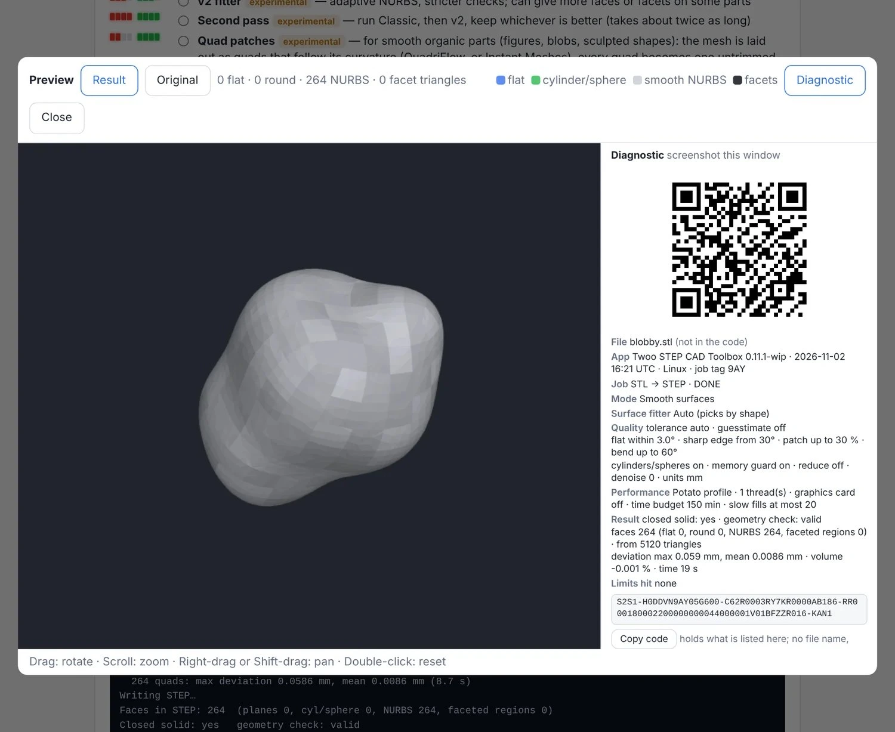

- Figure 9. The 3D preview of a result (left) and the diagnostic window (right): settings, profile and result as plain text and as one QR code, so a screenshot is a complete bug report. Screenshot of 0.11.1-wip.

#### ▲D13. Smaller disclosures

- Winding repair by a compiled graph search: triangles turned to agree with their neighbours by scipy's connected-components / breadth-first search over the faceadjacency graph instead of a pure-Python walk (28× faster; a 162,000-triangle figure with 30 % flipped faces 26.1 → 9.4 s).

#### Shape guessing written out as plain array operations in a fixed order (bit-

- identical, about 8 % faster in all).
- Quality presets as plain values of existing settings (Draft, Quick, Standard, Fine), so a preset run and the same settings made by hand are the same job and the same diagnostic code.
- Signals before reduction: never reduce the mesh before the normal histogram or hardpoint labels are read; snap near-equal axes and radii only after the tolerance gate, and re-check.
- A projector per surface: one point-on-surface projector set up per surface and reused (identical results, a tenth to a third off the plate filler's measuring loop).

#### ▲D14. Hardpoints (published separately)

The hardpoint STL format (an ordinary STL that also remembers which CAD face each triangle came from) and its use as hints that the fitter must still confirm are disclosed in the author's earlier paper, A POINT of contention, and in HARDPOINT\_STL.md in this repository.

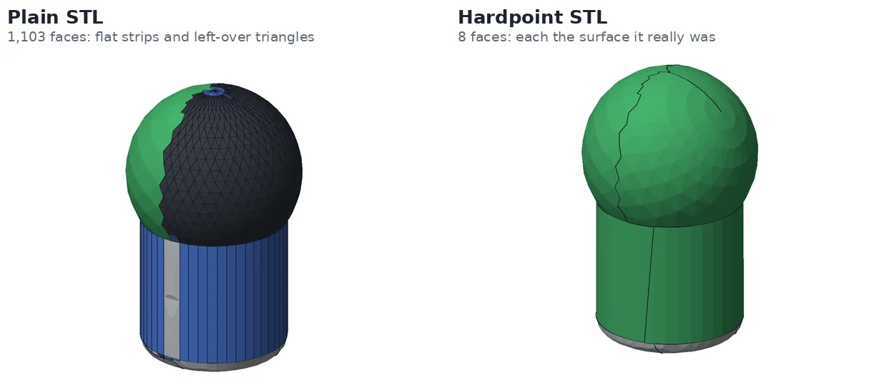

- Figure 10. The same knob converted from a plain STL and from a hardpoint STL.

#### ▲D15. Checking the finished solid the other way round, and picking the engine by shape (0.10.2)

Problem. Every face was checked for lying on the mesh, never for covering its own part of the mesh. A cylinder face built round the wrong side of an oval wall passed every check (right size, on the mesh) and left 155 mesh points 3.6 mm from the result. Separately, round faces that OpenCascade cannot triangulate after the STEP round trip measured as holes (3.0 mm on a test plate), and a checker that meshed faces one at a time and coarsely found only one of three.

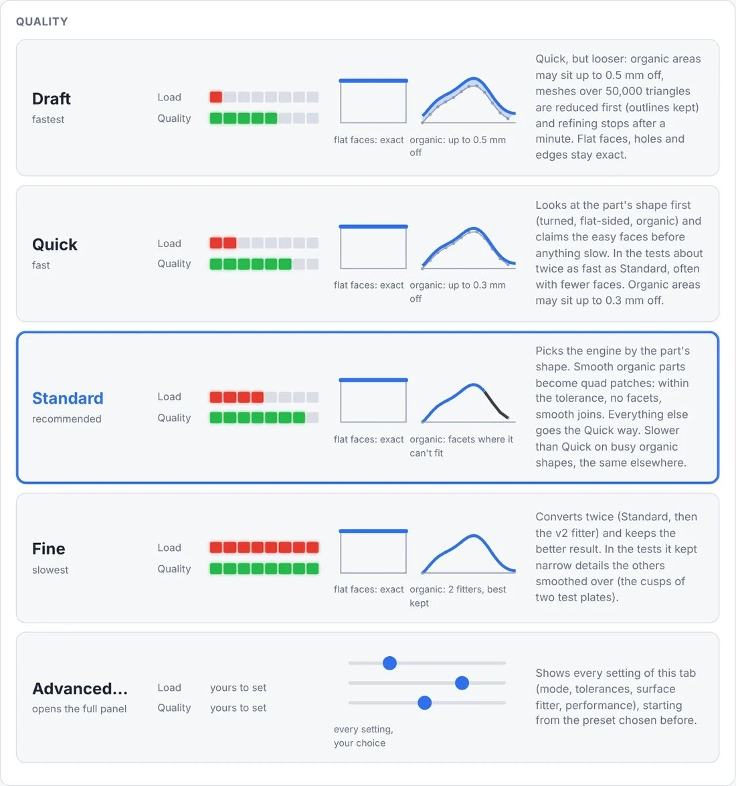

- Figure 11. The four quality presets as the app shows them: each is only a set of values for settings that already exist. Load (red) and quality (green) are on the same scale as every other setting. Screenshot of 0.11.1-wip.

Method. Disclosed:

1. After assembly the solid is written and read back, and checked on the finished solid (not per face while building: half a sphere only becomes right once its partner has mended the shared seam, and a per-face test refused it).
1. The working mesh's triangle centres and corners (up to 30,000 of each, a fixed random subset) are measured against the finished solid's own triangulation; a point more than three times the tolerance away (plus 1.5 × the triangle's chord sag for a centre) marks the region under it, which is rebuilt as exact facets.
1. Round faces are judged drawable by meshing the whole solid at once at the deviation measurement's fineness (0.2 × tolerance) and comparing each face's triangulated area with its exact area (within 3 %); a failing face's centre of mass, projected onto its surface, picks its region. Face merging is ruled out first (merge more carefully, up to twice), then the region is rebuilt as facets.
1. Disclosed: every such check meshes a deep copy of the shape with its old
- triangulation cleared, because meshing the same OpenCascade shape twice can make its mesher refine without end (0.9 s the first time, over five minutes the second on a test vase).
1. Disclosed: engine choice by shape for the default preset. The organic-suitability test of D9 decides; a suitable part goes to the quad-patch engine and its result is kept when within twice the tolerance, otherwise (or for any other part) the routed ladder of D2 runs. The two-pass preset runs that, then a second fitter, and takes the second when the first missed its tolerance and the second is under 0.8 × its deviation.

Measured. Oval plate 3.658 → 0.083 mm, blobs plate 3.000 → 0.176 mm, every other test mesh unchanged; the default preset over 12 CAD-style meshes 305 → 176 s and 15,744 → 2,394 faces, and over 5 organic shapes from 3 to 5 of 5 within the tight tolerance with no facets.

Variants disclosed. Any sampling of the mesh (all vertices, area-weighted points, only boundary-adjacent triangles); any distance threshold; rebuilding the uncovered region as a different surface type, or re-fitting its neighbours, instead of facets; drawability judged by any mesher or by a STEP reader of another kernel; engine choice by any classifier of the mesh.

#### ▲D16. Graphics-card scoring that cannot fail a conversion (0.11.1, 0.11.2)

Problem. The v2 fitter splits a smooth area made of several rounded shapes by guessing: it builds a few hundred plane, cylinder and sphere hypotheses from pairs of nearby triangles and scores each one against a sample of up to 1,500 triangles of the area, thousands of times in a run. That is plain arithmetic on arrays and a good fit for a graphics card. The risks are that a card is listed but cannot run the maths, and that a card problem fails a job.

Method.

- Score = supported area. For each hypothesis, the total area of sample triangles whose three corners lie within the tolerance of the shape, whose centre lies within a looser tolerance, and whose normal agrees with the shape's own normal there. The hypotheses go in as rows of parameters, one block per shape kind.
- The card is used only after a real test. Before a card is ever used, the actual scoring is run on it on a tiny made-up mesh (planes, cylinders and spheres), and the answers must be finite and of the right shape. The word "available" is not trusted: PyTorch can report a Pascal card (GTX 10-series) as available and then fail every operation with "no kernel image is available". If the test fails, the card is ignored and the plain NumPy path runs.
- Never fail a job. If a block fails on the card mid-conversion, the rest of that call is scored in NumPy. A card problem can slow a conversion; it cannot stop one.
- Single precision, converted on the processor. Apple's Metal backend has no 64-bit floats at all. Inputs are converted to 32-bit on the processor before moving to the card, and the answer is brought back to the processor before widening. (An earlier version asked the card for a 64-bit answer, so on a Mac the card path always threw and silently fell back: no Mac had ever used its card until this was found on the first real test.)
- Pick the build by card generation. Apple Silicon and recent Nvidia cards use the standard PyTorch build; Pascal, Maxwell and Volta cards need the CUDA 12.6 build ( torch>=2.6,\<2.15 , the last line that has it); AMD and Intel graphics are reported as not usable, with the reason.
1. 0.11.2: fewer round trips. For one batch of guesses the sample is uploaded once and reused for every block; all blocks are queued without waiting; the answers are read back once; blocks are 1,024 guesses instead of 256. The same arithmetic, so the same answers, with the fixed costs (uploading, waiting for the card) paid once.

Measured. Same answers: the card maths run on PyTorch's processor build agrees with NumPy (1e-15 relative in the tests), and a whole v2 conversion with the 0.11.2 path gives the same face count and maximum deviation as the NumPy path (17 faces, 0.277995 mm on a smooth test body). On a real card: the author reports an M5 MacBook converting the Halloween cat about twice as fast with the card on than off. The 0.11.2 change has not been timed on any real card.

Why only twice. The card speeds up one step. The rest of a conversion (building faces, sewing, writing the file) is OpenCascade, which only runs on the processor, and in the Fine preset on the Extreme profile the two passes run side by side, so the job lasts as long as the slower one. If everything else is unchanged, an overall 2× means the scoring was at least half of the run, even for a card that is infinitely fast (the second figure below is that arithmetic, not a measurement of the cat).

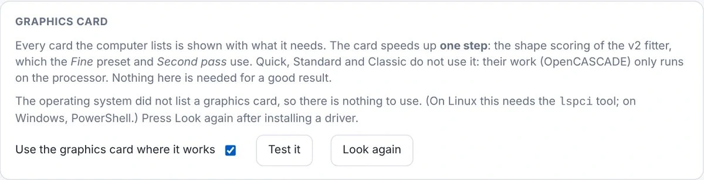

- Figure 12. The Graphics card box: every card the computer lists, whether it can be used, one button that installs the right PyTorch build, and Test it, which times the card against the processor. Screenshot of 0.11.1-wip on a computer with no usable card.

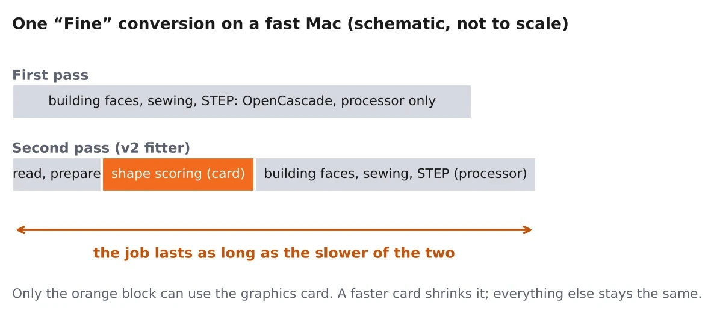

- Figure 13. What the card can and cannot speed up in one Fine conversion. (Schematic, not measured.)

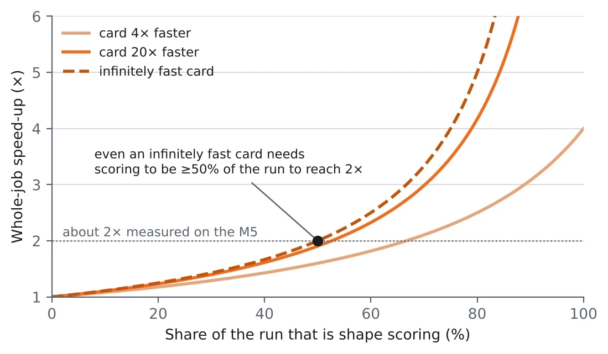

- Figure 14. The limit on any card: overall speed-up against the share of the run that is shape scoring. An overall 2× needs scoring to be at least half the run, however fast the card. (Calculated, Amdahl's law.)

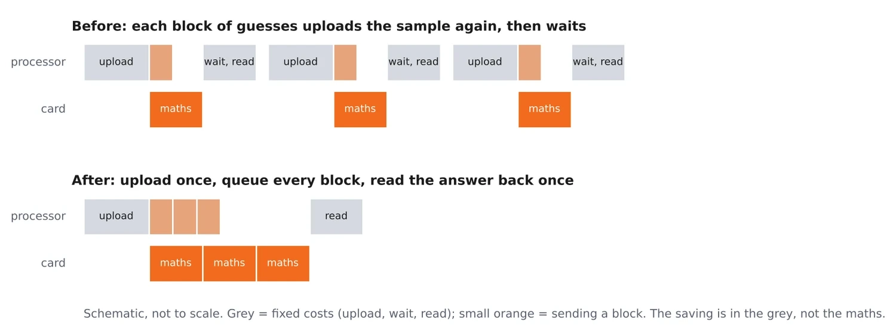

- Figure 15. The 0.11.2 change: the sample is uploaded once, blocks are queued, and the answer is read back once. (Schematic, not to scale.)

Variants disclosed. Any other array library or graphics interface (Metal, CUDA, ROCm, oneAPI, Vulkan compute, OpenCL, WebGPU) in place of PyTorch; 16-bit or mixed precision with a processor re-check of the best few; any batch size; scoring more shape kinds (cones, tori, extrusions); moving other array-heavy steps (distance queries, residuals) to the card; and using several cards. The gate (run the real work on a tiny problem before trusting the card, fall back silently, never fail the job) applies to any of them.

#### ▲D17. A triangle ceiling per performance profile (0.11.2)

Problem. On a weak computer the time of a conversion grows with the triangle count, and a memory guard that only looks at free RAM lets a 90,000-triangle organic mesh run for far longer than the owner of an old laptop will wait.

Method. Each performance profile carries a triangle ceiling (Potato: 30,000; Moderate and Extreme: none). The number travels to the worker process as one environment variable, like the profile's other numbers. When a mesh is loaded and it is larger than the ceiling (and no smaller reduction was asked for), it is reduced to the ceiling by the method of D4 (outlines of flat faces, holes, cylinders and sharp edges locked first), the log says so, and the same rule applies in every engine. Turning the memory guard off, or choosing another profile, converts at full size.

Measured (one synthetic organic body, 81,920 triangles, closed, Quick engine, a 2-core Linux machine, tolerance 0.3 mm; every result a closed, valid solid inside the tolerance):

Mesh given to the engine | Time | Faces | Worst gap to the mesh  
whole, 81,920 triangles | 106.7 s | 25 | 0.219 mm  
reduced to 40,000 | 85.6 s | 26 | 0.267 mm  
reduced to 30,000 (the Potato profile) | 59.8 s | 23 | 0.234 mm  
reduced to 20,000 | 45.5 s | 252 | 0.215 mm

The price. A smooth body can come out as more, smaller faces (25 faces whole, 252 at 20,000 on the same body), so this is switched on only for the profile whose owner has chosen "light and slow" over "smooth". The number 30,000 comes from these four points on one synthetic body and has not been tuned on real models.

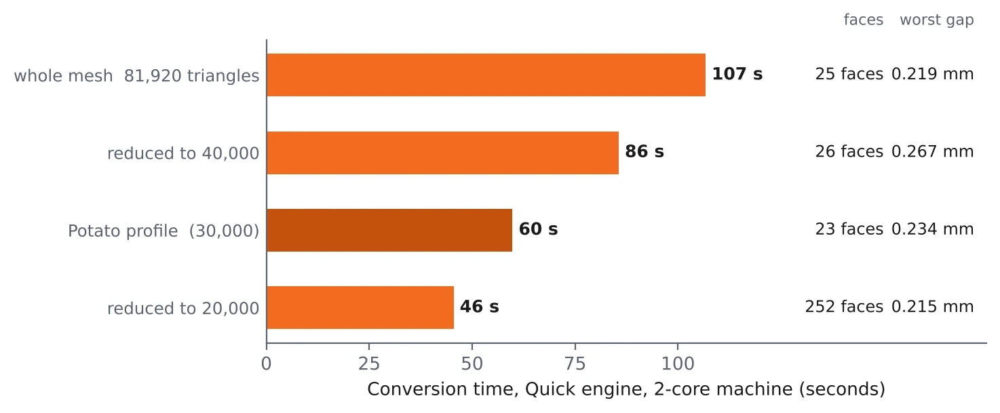

- Figure 16. Measured: time, face count and worst gap for the same body at four mesh sizes (Quick engine, 2-core machine).

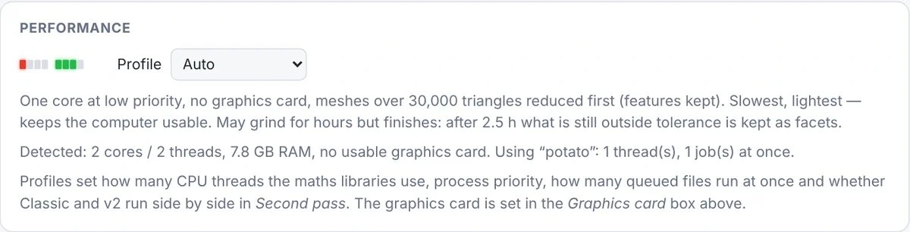

- Figure 17. The Performance box on a 2-core, 8 GB machine: Auto picked Potato, and the description says what that means. Screenshot of 0.11.1-wip.

Variants disclosed. A ceiling set per profile, per engine, per route, from the core count or from the free RAM; a ceiling learned from a quick timing of the machine; progressive reduction (convert a small version first, refine only what is inside the tolerance); ceilings by memory, by time budget, or both; and any reduction method that keeps the outlines of exact regions fixed.

## 4. The free research, in one place

The project's research is published in full, with every source link, in docs/research/ . The reports were written by an AI research agent and not independently verified; the working notes are measurements. The headline findings, including the ideas that turned out to be bad, because bad ideas are prior art too:

- FULL\_REPORT.md: the time and the bloat are in fallbacks, not fitting (67 % of the 41-minute run in the plate filler; 40,000 of 40,484 faces facets). Claim exact shapes first; rebuild the freeform stage around untrimmed four-sided patches; speed comes from measuring less often, processes instead of threads (the OpenCascade binding never releases Python's lock) and the right distance library (trimesh 32 s against pysdf 0.059 s for 500,000 queries), not a GPU. No vendor publishes numbers, so a public benchmark is the most credible claim a free project can make.
- MACHINE\_VISION.md: rendering the mesh and running image detectors throws away exact data and cannot measure to CAD tolerance (a 1024-pixel image of a 200 mm part is 0.2 mm a pixel). The vision toolbox (histograms, voting, contour tracing) applied to the mesh's own data is what helps. Small learned models are slow, brittle or unlicensed on a GPU-less i3.
- COMBINING.md: the techniques form one ladder, whose value is the work it lets you skip (on the blob, three quarters of the time was a flat search that finds nothing). Once a boundary exists it is vertex data: fitting vertices beat a per-hole render (2–60 ms per region with r = 1.500000, against 4–65 ms per hole with sub-micron bias).
- EASY\_FIRST.md: simple-first is safe only with two gates (D1); three millisecond signals route 25 of 26 meshes (D2); routing is mandatory (the same staged path is a 20× win on vases and a 2× loss on a plate); caps on settling passes, fills and the faceted fallback matter more than refinement rounds.
- POTATO.md: out-of-memory inside the kernel can't be caught, so write a file early and treat everything after it as optional (D7); OpenCascade can cancel meshing, booleans, sewing, plate surfaces and STEP transfer cooperatively but not validity checks or repairs, so a hard ceiling needs a killable child process.
- SLICER.md: slicing the STL like a 3D printer with a 0.001 mm "nozzle" does not help.
- A STEP solid has no inside, so the coarse-infill saving is already total; vertical walls are exact at any layer height; tops and domes stair-step by the layer height, which a finer nozzle doesn't touch; 0.001 mm is finer than the mesh's own chord error, so it reproduces the facets. The useful "nozzle" is the line/arc fitter's tolerance. Worth keeping: a section at every flat level and at every change in loop count, each slab extruded or lofted.
- IMPROVEMENTS\_0\_10.md: the five defects behind D4–D6 and D10, found by profiling and by diffing every decision of repeated runs; also the 0.0001 mm-nozzle question again (still no) and the costed sketch that became D8.
- QUADPATCHES.md: every measurement behind D8 and D9, and how QuadriFlow is built and shipped from pinned sources under permissive licences only.
- NATIVE.md, EFFICIENCY.md: what runs in compiled code (OpenCascade, NumPy, SciPy, GEOS, libspatialindex, OpenCV do the heavy lifting); where Python sat in the way and what came out of it.
- PRESETS.md: how the four presets were chosen from 12 test meshes (Draft 158 s, Quick 163 s, Standard 370 s, Fine 702 s in all; Exact facets measured as a "fastest" candidate and slower than Quick on every organic part).
- DIAGNOSTIC\_CODE.md, PLUGIN\_SYSTEM.md, TRANSITION\_TRACING.md, CALSHEET.md: the diagnostic code, the drop-in plug-in system, and the Image → STEP tab's tracing and calibration sheet.
- GHOST\_CAT.md: the first real-world field report (section 5).
- ../guide/gpu.md and ../guide/performance.md (v1.2): what the graphics card does and does not speed up, the card-by-card support table with its sources, the profiles, and why a card cannot make a whole job many times faster (D16, D17).
- ../../LTS\_POLICY.md and ../KNOWN\_LIMITATIONS.md (v1.2): what the long-termsupport project promises from 1.0.0 on, the gates not yet met, and what has and has not been tested.
- STANDARD.md: why the old default preset did so badly on the real cat, and the new one (D15).

Licence findings, for anyone building on this. QuadriFlow, Instant Meshes, cadqueryocp (OpenCascade) and the MIT-licensed converters are permissive. CGAL's algorithm packages, pymeshfix and several research codes are GPL or AGPL; Point2CAD is CC-BY-NC; slicer source code (PrusaSlicer, CuraEngine, ArcWelder) is AGPL. None of that is copied into this project; where an idea was useful, it was re-implemented from the published

description.

## 5. Field report: a ghost cat on a MacBook

On 23 October 2026 the author converted a real downloaded model, "Halloween Cat Stretching" from A Trio of Halloween Ghost Cats by OddPlasticity on Printables (a thirdparty model, used only as a test and not included anywhere in this project; 91,676 triangles), on an Apple M5 MacBook with no GPU support. The numbers were read by the app from phone photos of its own diagnostic QR codes (D12):

Preset | Time | Faces (NURBS, facet areas) Max / mean deviation  
Standard (Classic) | 4 min 23 s 17,197 (829, 1,164) | 1.110 / 0.0111 mm  
Quick (Ladder, organic route) | 81 s | 11,864 (467, 808) | 0.228 / 0.0214 mm  
Draft (Ladder, Guesstimate 0.5 mm) 79 s | 11,117 (427, 734) | 0.271 / 0.0234 mm

An earlier Standard run took about 10 minutes and gave a 50 MB STEP; in Fusion the body is large smooth NURBS patches, with facet areas at the eyes, the fringed hem and some spots. The face totals are mostly facets: about 16,000 facet triangles to 829 NURBS patches in Standard, which also explains the file size (about 2.4 KB per facet, 16 KB per NURBS face). Standard's 1.110 mm worst point is outside its own tolerance and is an open defect. Details in GHOST\_CAT.md.

#### ▲Update, 29 to 31 October 2026 (version 1.2): the same cat with the graphics card

The first try of the card on that MacBook failed (the 64-bit bug of D16), was fixed, and was run again. The author reports: with the card on, the cat converted about twice as fast as with it off, and a whole cat conversion on the M5 now takes about 2½ minutes. These two numbers are the author's report, not read from a diagnostic code, and the preset used for them was not recorded. They are therefore not comparable with the table above, and the paper does not claim they are. What they do show is that the card helps and that most of the run is not the card's to help (second figure of D16). The 0.11.2 change of D16 and the ceiling of D17 came out of the question of what else could be done, particularly for computers that are not an M5.

## 5b. The program as it looks today (version 1.2)

Twoo STEP CAD Toolbox is the same maths as EVERYTHING to solid 0.10.2-wip in a new shape: one program, with each tool a plug-in that also works alone and inside FreeCAD or Fusion, and one shared core for the job runner, the profiles, the card and the diagnostic code. The screenshots below were taken from version 0.11.1-wip running on a 2-core Linux test machine.

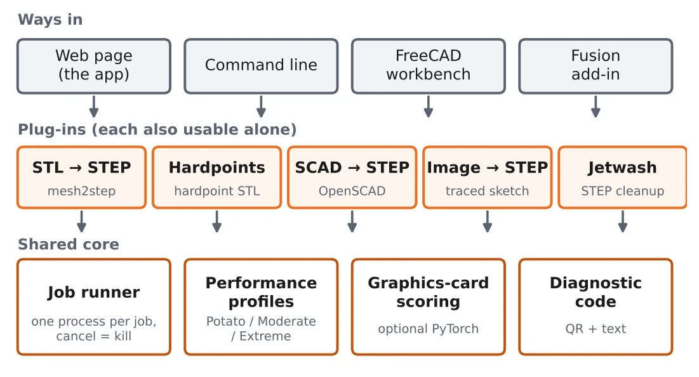

- Figure 18. How the toolbox is put together: four ways in, five plug-ins, one shared core. (Schematic.)

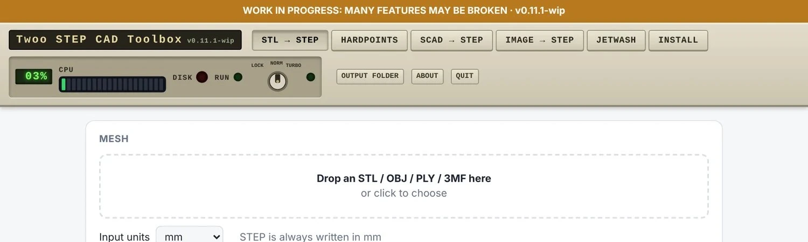

- Figure 19. The top of the app: a tab for each plug-in, a CPU meter and disk and run lights.

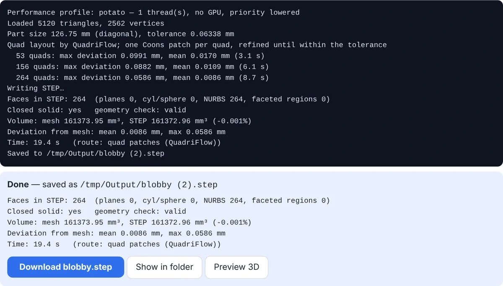

Figure 20. A conversion's log and result: the route taken (quad patches), the shape counts, the solid and validity checks, and the measured deviation from the mesh.

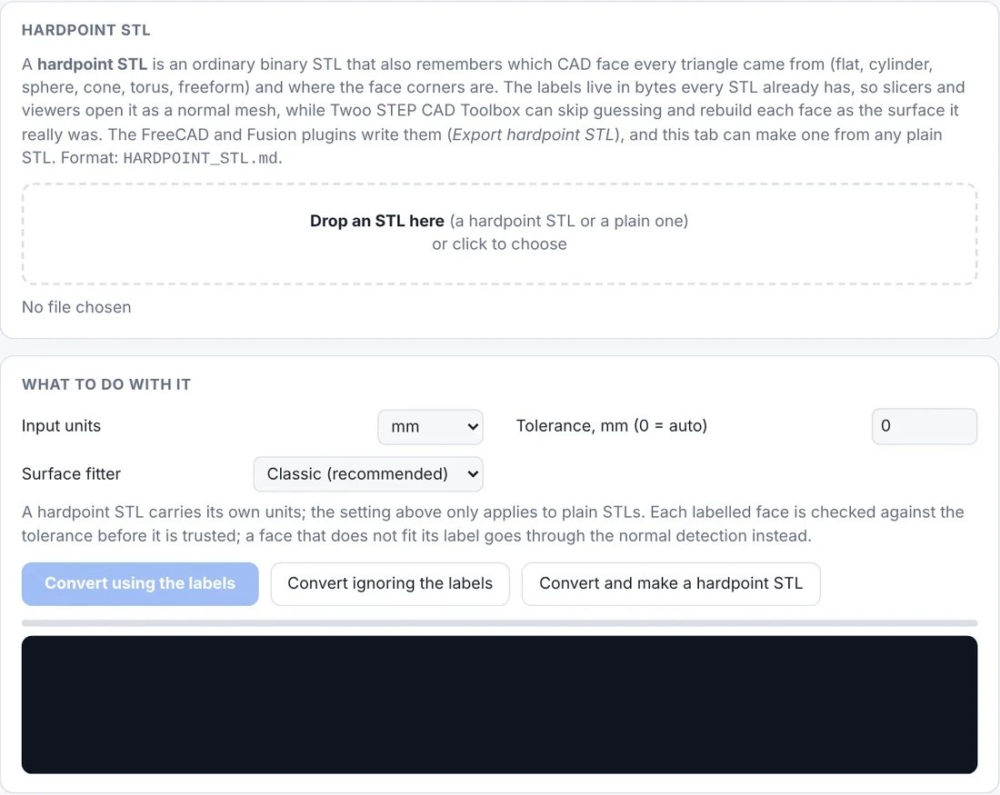

- Figure 21. The Hardpoints tab: convert using, ignoring or while making a hardpoint STL (D14).

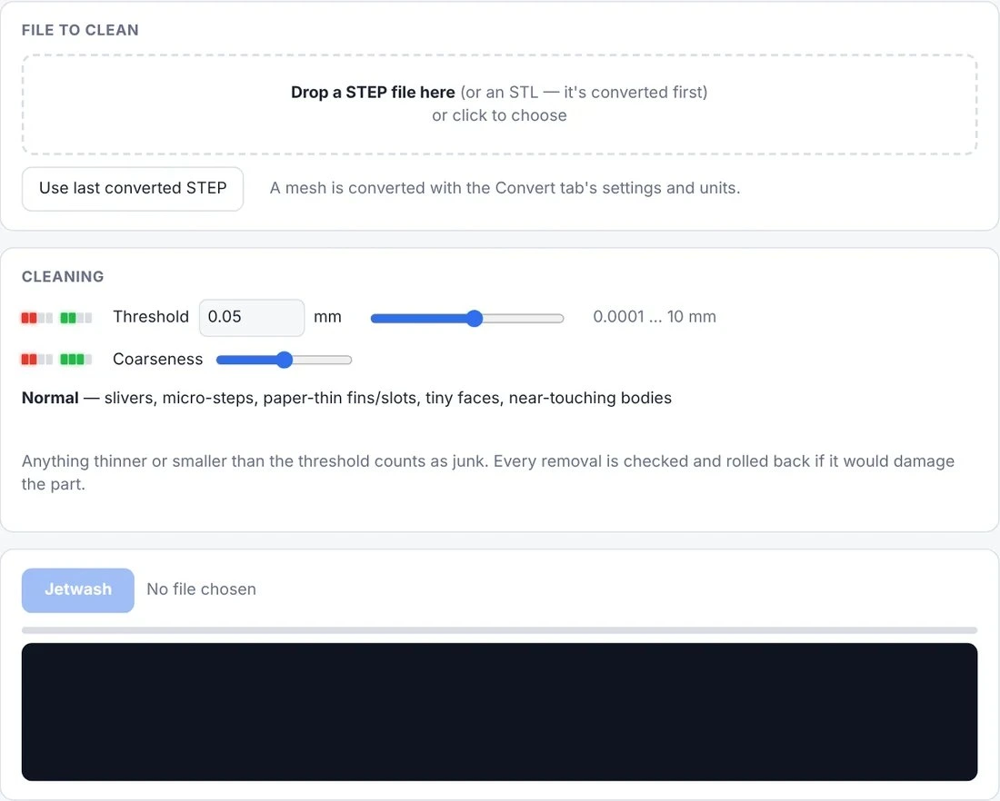

Figure 22. The Jetwash tab: a threshold and a coarseness slider for cleaning tiny junk faces out of a STEP file (D10).

- Figure 23. The Install tab: put the toolbox into FreeCAD or Fusion, or add right-click entries.

## 6. What is not done or not tested (honesty ledger)

Every measurement except section 5 is from synthetic test shapes on a 2-core Linux machine; nothing has run on the target 7th-generation i3 or 11th-generation i5. Quad patches: no real scans or sculpts; QuadriFlow built and run on Linux only; Instant Meshes on Linux only; it refuses parts with sharp edges, which includes most real figurines with crisp rims (the synthetic ghost: "1.0 % of its edge length is sharper than 30°").

Not built yet, but disclosed as an idea: per-region hybrid output, quad patches on the organic regions and exact faces on the sharp or turned regions, joined along shared curves; a hard time ceiling by killable child processes; per-island slab lofts for turned parts with no findable axis.

The plug-ins for FreeCAD and Fusion were tested against stand-ins, not in the real programs.

(v1.2) Graphics card: timed on one real card only, an Apple M5 (about 2× on the whole job, by the author's report, preset not recorded). The 0.11.2 round-trip change has been timed on no real card. The Nvidia route (including the GTX 10-series build), and AMD and Intel graphics, have never been run on a real card, and AMD and Intel are not supported. The limit of any card is the share of the run that is scoring, which has not been measured for the cat.

(v1.2) Triangle ceiling: measured on one synthetic body on a 2-core Linux machine, four sizes, one engine. The value 30,000 is a first guess, and the cost in face count is real (25 faces became 252 at 20,000 triangles on that body). Not tried on the 7thgeneration i3 it is meant for, or on any real model.

#### (v1.2) Not run on a real Windows PC, FreeCAD or Fusion (gates 3 and 4 of

LTS\_POLICY.md ); the Mac has had one field report, the one above. Dependencies are version ranges, not pins.

## 7. How to cite this

Armstrong, M. (2026). SOLID evidence: a defensive publication of how EVERYTHING to solid turns triangle meshes into CAD solids, with all the free research behind it. Version 1.2, 2 November 2026 (first published as version 1.0, 23 October 2026; D1–D15 unchanged since version 1.1, 24 October 2026). https://github.com/The-Dorkknight/twoo-step-cadtoolbox/blob/main/docs/research/SOLID\_EVIDENCE.md (The first version was published at https://github.com/The-Dorkknight/stl2step/blob/main/docs/research/SOLID\_EVIDENCE.md, now frozen.)

Required Notice: Copyright Matthew Armstrong (https://github.com/The-Dorkknight). The software described is licensed under the PolyForm Noncommercial License 1.0.0. This document may be copied and shared unchanged, with this notice, so that it can serve as prior art. Not legal advice.
